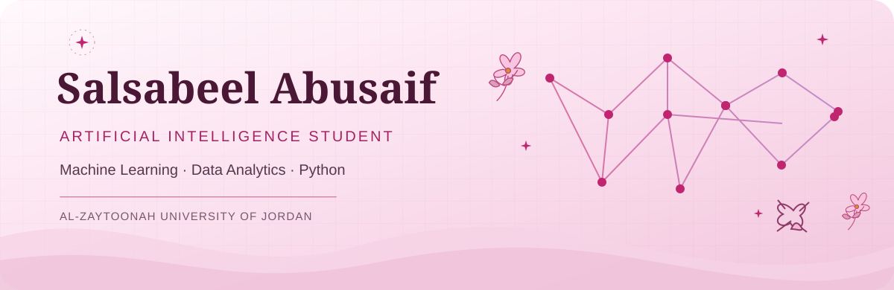

  

  

  <a href="https://github.com/salsabeelabusaif005-debug">GitHub</a> &nbsp;·&nbsp;
  <a href="https://www.linkedin.com/in/salsabeel-abusaif">LinkedIn</a> &nbsp;·&nbsp;
  <a href="mailto:salsabeelabusaif005@gmail.com">Email</a>

<strong>Artificial Intelligence Student · Machine Learning · Data Analytics</strong> Al-Zaytoonah University of Jordan · Jordan · Expected graduation: February 2028

<em>🌷 Thoughtful analysis · practical AI · a little floral inspiration 🌷</em>

---

## Profile

I’m an Artificial Intelligence student interested in machine learning, data analytics, and building practical solutions to real-world problems. I enjoy the analytical process: preparing data, exploring patterns, and communicating useful findings. My project work includes SQL-based sales analysis and a sensor-driven line follower robot. I’m continuing to develop my skills in machine learning, deep learning, and large language models.

✿　✿　✿

## Technical toolkit

  <strong>PROGRAMMING</strong> 
  
  
  

  <strong>DATA &amp; MACHINE LEARNING</strong> 
  
  
  
  
  

  <strong>DATABASES &amp; TOOLS</strong> 
  
  
  
  
  
   Also: Microsoft Access · MySQL Workbench · Google Colab

  <strong>ROBOTICS &amp; WEB</strong> 
  Arduino · Sensors · PCB design · Angular (frontend fundamentals)

<strong>Currently developing:</strong> Machine learning · Deep learning · LLMs

🌸 ─────── ✧ ─────── 🌸

## Selected projects

### Sales Analysis with SQL

A MySQL analysis of fictional retail data, exploring revenue, monthly trends, leading customers, and category performance.

- **Methods:** `JOIN`, `LEFT JOIN`, `GROUP BY`, `HAVING`, subqueries, `DATE_FORMAT`
- **Tools:** MySQL · MySQL Workbench
- **Sample finding:** Electronics contributed over 90% of revenue in this fictional dataset.
- **Repository:** [View the project](https://github.com/salsabeelabusaif005-debug/sql-sales-analysis)

### Line Follower Robot

Built and programmed a sensor-based line follower robot; participated in the National Line Follower Robotics Championship (NLFRC 2026).

- **Technologies:** Arduino · Sensors · PCB design

🌷 ─────── ✧ ─────── 🌷

## Training & milestones

| Date         | Milestone                                             | Details                                                                                                                                                         |
| :----------- | :---------------------------------------------------- | :-------------------------------------------------------------------------------------------------------------------------------------------------------------- |
| **Aug 2026** | **Automation &amp; Artificial Intelligence Workshop** | Flasha Academy · Certificate of Attendance                                                                                                                      |
| **Jul 2026** | **Robotics Training &amp; NLFRC 2026**                | TechBots · 70+ training hours · Certificate of Participation                                                                                                    |
| **Jun 2026** | **Python Essentials 1**                               | Cisco Networking Academy &amp; OpenEDG · 30 hours · [Verify certificate](https://www.netacad.com/certificates/?issuanceId=9e45b3e0-9f1d-4456-92aa-dc1b493051ac) |
| **Feb 2026** | **System Integration Workshop**                       | FLASHA · Certificate of Achievement                                                                                                                             |
| **Feb 2026** | **Angular Frontend Workshop**                         | FLASHA · Certificate of Achievement                                                                                                                             |
| **Jan 2026** | **Zaytoonah Coding Contest**                          | iTeam, Al-Zaytoonah University · Certificate of Appreciation for participation                                                                                  |

## Beyond the screen

I love flowers and cats; they bring a little calm and color to my days.

🌸 ─────── ✧ ─────── 🌸

## Contact

Open to AI/ML internship opportunities and project collaboration.

- **Email:** [salsabeelabusaif005@gmail.com](mailto:salsabeelabusaif005@gmail.com)
- **LinkedIn:** [linkedin.com/in/salsabeel-abusaif](https://www.linkedin.com/in/salsabeel-abusaif)
- **GitHub:** [github.com/salsabeelabusaif005-debug](https://github.com/salsabeelabusaif005-debug)

